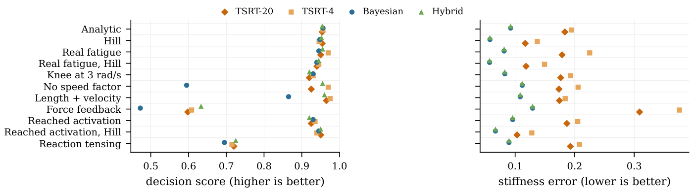
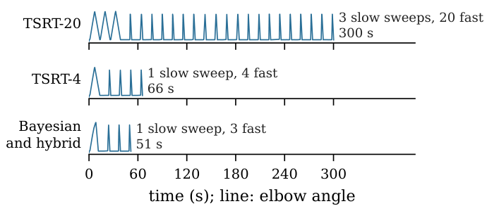

# Baseline scenarios, protocol timeline and departures from the published method

This page holds material that does not fit in the conference paper. The code is in `elbow/world.py`; parameter ranges are
in `PATIENT_PARAMETERS.md`.

## Scenarios of the sixth (baseline) test

Each scenario changes one thing against the base patients, and has 200 patients per body. Run one with
`--scenario <name>` (see the README).

| Name in code | Name in the figure | What changes |
| --- | --- | --- |
| `knee3` | Knee at 3 rad/s | The reflex speed factor saturates at 3 rad/s instead of 1 rad/s. |
| `flat` | No speed factor | The reflex depends on speed only through its threshold. |
| `sum` | Length + velocity | Separate length and velocity terms, each with its own threshold, as in SpasticMyoElbow (Yu et al. 2025). |
| `force` | Force feedback | The reflex is driven by muscle force and its rate, as in Falisse et al. 2018 (force threshold 2 N m). |
| `early` | Real fatigue | The reflex falls fast over the first stretches to a plateau, and rest does not bring it back: fast rate 1 to 2 per second of full activation, recovery 1200 to 3600 s, floor 0 to 0.2. Set to the curve of 18 people in Patterson et al. 2022. |
| `greach` | Reached activation | Angle-dependent background activation (2 to 5 N m) that starts early enough (30 to 55% of the range) for fast stretches to enter it, and grows with speed (factor 0.5 to 2). It can mimic a reflex. |
| `react` | Reaction tensing | A tensing that starts a reaction time (0.15 to 0.3 s) after a fast stretch begins, with no angle gate, peaking at 1 to 3 N m at 3.2 rad/s. It can mimic a reflex. |

Some scenarios were run on both bodies, which gives the rows of the figure below.

*Decision score (higher is better) and stiffness error (lower is better) with EMG, for the four protocols in each baseline
scenario.* The hybrid had lower stiffness error than TSRT-4 in every scenario. Force-feedback reflexes were found in only
about half of the patients; reached activation was often called a reflex, and reaction tensing almost always was.

## Protocol timeline

*Elbow angle over time in one session of each protocol, for the same development patient on the Hill body. Each peak is a
stretch; the slow ramps are sweeps. The hybrid uses the Bayesian session.*

## How the robot protocols depart from the published TSRT method

| | Published (Calota et al. 2008; Piscitelli et al. 2025) | This work |
| --- | --- | --- |
| Stretch | Manual, bell-shaped | Motor, trapezoidal, 0.6 to 3.2 rad/s |
| Onset | 2 to 3 times baseline, held 15 to 50 ms | Tuned margin (mean + 3 sd + 0.5 Q, after artefact removal), held 50 ms |
| Reflex yes/no | Not defined | Ours (onsets in at least half of the stretches at the two highest speeds) |
| Tissue | Not reported | Stiffness and range from slow sweeps |
| Calibration | None | Fixed offsets on development patients with known truth |
